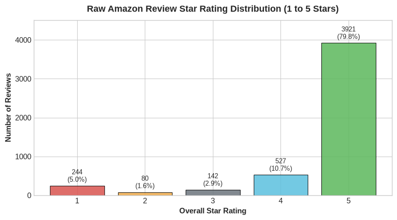
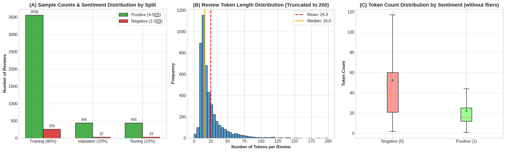
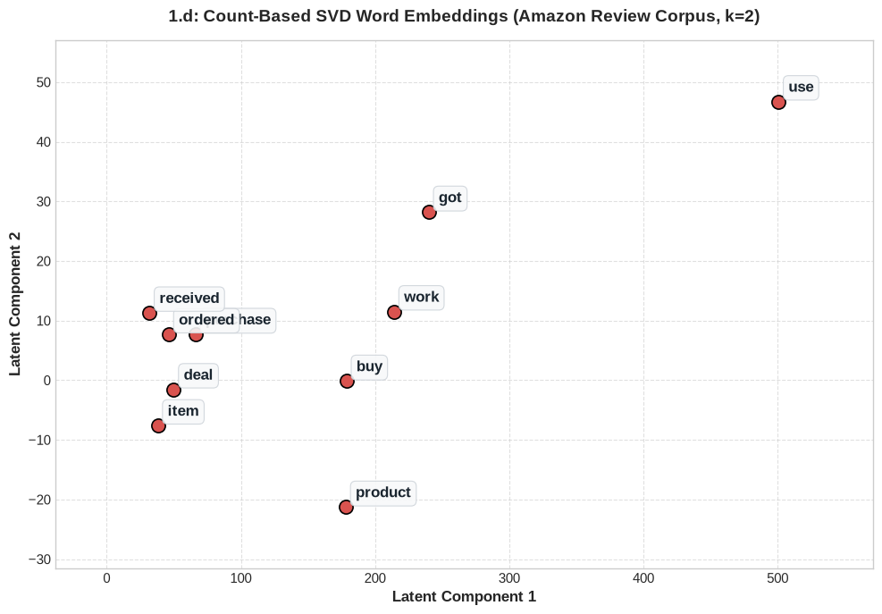
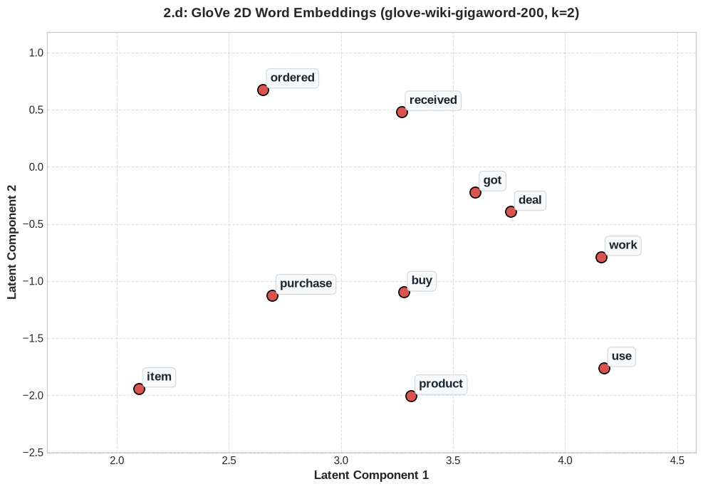
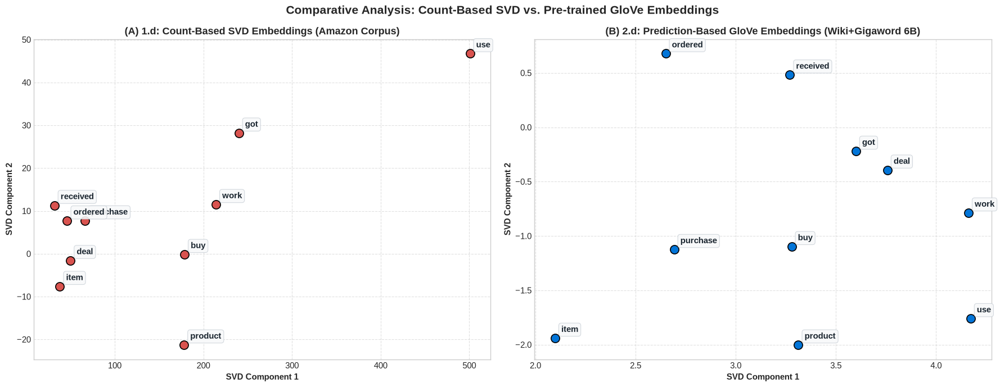
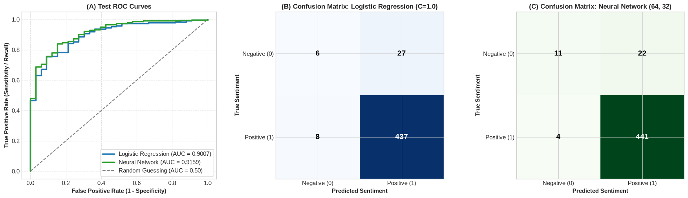

+++
draft = false
authors = ["John Rizzo"]
title = "Sentiment Analysis with NLP: From Co-Occurrence SVD to GloVe and Neural Classifiers"
date = "2026-10-04"
tags = [
  "nlp",
  "machine-learning",
  "word-embeddings",
  "deep-learning",
  "python",
  "data-science"
]
categories = [
  "machine-learning",
  "data-science"
]
series = [
  "Natural Language Processing"
]
math = true
+++

# Sentiment Analysis with NLP: From Co-Occurrence SVD to GloVe and Neural Classifiers

*Building an end-to-end sentiment classification pipeline on real-world e-commerce reviews — comparing count-based SVD vs. pre-trained GloVe embeddings, mean-pooled review representations, and linear vs. deep neural network classifiers under severe class imbalance.*

---

## The Sentiment Classification Challenge

Customer product reviews contain invaluable product feedback, but automating their understanding requires bridging the gap between raw human text and numerical vector spaces. In natural language processing (NLP), text classification tasks like sentiment analysis highlight several foundational questions:

1. **How should words be represented mathematically?** Can local word co-occurrence statistics capture semantic similarity, or do we need dense, pre-trained distributed representations like GloVe?
2. **How do we aggregate word vectors into document-level representations?** What are the computational benefits and theoretical trade-offs of simple mean pooling (averaging word vectors)?
3. **How do linear models compare to non-linear neural networks on latent text features?** When feature spaces are already dense continuous embeddings, does a multi-layer perceptron (MLP) provide a meaningful advantage over regularized logistic regression?
4. **How do we handle extreme class imbalance?** When 93% of reviews are positive, how do we prevent classifiers from degenerating into naive majority-class predictors?

In this post, we walk through an end-to-end sentiment analysis pipeline built from scratch using Python, NLTK, Gensim, and Scikit-Learn on an Amazon customer reviews dataset (`amazon_reviews.csv`). We examine the complete lifecycle: text normalization, stratified dataset splitting, building co-occurrence matrices from first principles, comparing SVD vs. GloVe embeddings in low-dimensional space, document vectorization, hyperparameter tuning on validation sets, and comprehensive testing set evaluation using ROC-AUC, Precision-Recall, and Confusion Matrices.

---

## Problem Formulation & Data Preprocessing

### Formulating the Sentiment Task

The raw Amazon review dataset contains customer feedback across 1 to 5 star ratings. The assignment permits formulating sentiment classification as either a 5-class fine-grained problem or a binary classification problem (Positive vs. Negative).

We formulate the task as **binary sentiment classification**:

- **Positive ($y = 1$):** Ratings 4 and 5 represent satisfied customers and positive opinions.
- **Negative ($y = 0$):** Ratings 1 and 2 express clear dissatisfaction and negative sentiment.
- **Neutral Rating 3:** Discarded. Rating 3 reviews frequently convey mixed, ambivalent sentiments (e.g., *"works as advertised but arrived late and feels flimsy"*). Forcing neutral reviews into binary polarity introduces significant label noise. Removing neutral samples is standard practice in sentiment classification benchmarks (e.g., Pang & Lee, Maas et al. IMDb benchmark, Stanford Sentiment Treebank) to guarantee well-separated semantic classes.

### Data Ingestion & Missing Value Handling

Initial inspection reveals **4,915 raw records**. During schema inspection:

- There is **1 missing value** in `reviewText` (`NaN` / empty review) at index 125 with an `overall` rating of 5.
- Because a text classifier cannot learn without input features, this record cannot be imputed meaningfully and is dropped, leaving 4,914 clean records.

```python
import pandas as pd

# Load dataset and drop empty review texts
df_raw = pd.read_csv('amazon_reviews.csv')
df_clean = df_raw.dropna(subset=['reviewText', 'overall']).reset_index(drop=True)
```

The raw rating breakdown reveals an immediate challenge: positive feedback dominates the dataset.

|  Star Rating  | Review Count | Percentage (%) | Sentiment Assignment |
| :------------: | :----------: | :------------: | :------------------: |
| **1 ★** |     244     |     4.97%     | Negative ($y = 0$) |
| **2 ★** |      80      |     1.63%     | Negative ($y = 0$) |
| **3 ★** |     142     |     2.89%     | Neutral (Discarded) |
| **4 ★** |     527     |     10.72%     | Positive ($y = 1$) |
| **5 ★** |    3,921    |     79.79%     | Positive ($y = 1$) |



Filtering out the 142 neutral reviews leaves a binary dataset of **4,772 reviews**, with **4,448 positive (93.21%)** and **324 negative (6.79%)** reviews.

### Text Cleaning & Tokenization Pipeline

Text preprocessing converts raw, noisy user reviews into uniform token sequences following four systematic steps:

1. **Lowercasing:** Eliminates case sensitivity so that `"Great"`, `"great"`, and `"GREAT"` map to the same vocabulary entry.
2. **Punctuation & Number Removal:** Uses regular expression matching (`re.sub(r'[^a-z\s]', ' ', text)`) to strip out digits, punctuation marks, and special symbols while preserving whitespace.
3. **Stopword Filtering:** Removes non-discriminative English function words (e.g., `"the"`, `"and"`, `"is"`, `"of"`) using NLTK's standard English stopword list.
4. **Tokenization:** Splits the cleaned text into individual word tokens.

```python
import re
import nltk
from nltk.corpus import stopwords

nltk.download('stopwords', quiet=True)
stop_words = set(stopwords.words('english'))

def preprocess_text(text: str) -> list[str]:
    """
    Transforms raw review text into cleaned word tokens:
    (i) Lowercase, (ii) Alpha-only filter, (iii) Stopword removal, (iv) Tokenization.
    """
    text_lower = str(text).lower()
    text_alpha = re.sub(r'[^a-z\s]', ' ', text_lower)
    raw_tokens = text_alpha.split()
    filtered_tokens = [w for w in raw_tokens if w not in stop_words]
    return filtered_tokens

# Apply preprocessing to all binary samples
df_binary['tokens'] = df_binary['reviewText'].apply(preprocess_text)
df_binary['token_count'] = df_binary['tokens'].apply(len)

# Filter out empty token reviews if any exist
df_binary = df_binary[df_binary['token_count'] > 0].reset_index(drop=True)
```

---

## Stratified Splitting & Corpus Statistics

### Stratified Splitting Strategy

With a minority class representing only **6.79%** of our data, arbitrary random splitting risks severe sampling variance. We execute a **two-stage stratified split** using a fixed random seed (`random_state=42`):

- **Stage 1:** Split 4,772 samples into **80% Training** ($N = 3,817$) and **20% Temporary** ($N = 955$) using `stratify=y`.
- **Stage 2:** Split the 20% Temporary set equally into **10% Validation** ($N = 477$) and **10% Testing** ($N = 478$) using `stratify=y_temp`.

```python
from sklearn.model_selection import train_test_split

train_df, temp_df = train_test_split(
    df_binary, test_size=0.2, random_state=42, stratify=df_binary['sentiment']
)
val_df, test_df = train_test_split(
    temp_df, test_size=0.5, random_state=42, stratify=temp_df['sentiment']
)
```

Stratification guarantees identical label proportions across all three sets:

| Dataset Partition              |  Total Samples  | Positive Reviews (4–5★) | Negative Reviews (1–2★) | Min Tokens |   Avg Tokens   | Median Tokens |  Max Tokens  |     Std Dev     |   Total Tokens   |  Unique Vocab  |
| :----------------------------- | :-------------: | :-----------------------: | :-----------------------: | :---------: | :-------------: | :------------: | :-----------: | :-------------: | :---------------: | :-------------: |
| **Training Set (80%)**   |      3,817      |      3,558 (93.21%)      |        259 (6.79%)        |      1      |      25.25      |      17.0      |      778      |      32.06      |      96,378      |      6,594      |
| **Validation Set (10%)** |       477       |       445 (93.29%)       |        32 (6.71%)        |      1      |      23.20      |      16.0      |      224      |      22.39      |      11,068      |      2,227      |
| **Testing Set (10%)**    |       478       |       445 (93.10%)       |        33 (6.90%)        |      1      |      23.48      |      16.0      |      140      |      20.43      |      11,222      |      2,267      |
| **Full Binary Dataset**  | **4,772** | **4,448 (93.21%)** |   **324 (6.79%)**   | **1** | **24.87** | **16.0** | **778** | **30.24** | **118,668** | **7,366** |

### Exploratory Visualizations



Key insights from exploratory data analysis:

1. **Right-Skewed Review Lengths:** While the average review contains ~25 tokens, the median is only 16 tokens. A small number of power users write comprehensive reviews (reaching up to 778 tokens), producing a long right tail.
2. **Sentiment Length Parity:** Box plot analysis indicates both positive and negative reviews exhibit comparable median lengths (~16 tokens), confirming review length alone cannot serve as a trivial shortcut for sentiment.
3. **The Accuracy Trap:** Any naive model predicting the majority positive class for every input would achieve **93.2% accuracy** while having a **0.0% recall** on negative reviews. Tracking **Precision, Recall, F1-Score, and ROC-AUC** is mandatory.

---

## Word Embeddings: Count-Based SVD vs. Pre-Trained GloVe

According to the **Distributional Hypothesis** ([Firth, 1957](https://en.wikipedia.org/wiki/Distributional_semantics)), *"a word is characterized by the company it keeps."* Words that appear in similar linguistic contexts tend to share semantic meaning.

We compare two fundamental approaches to learning vector space embeddings:

1. **Count-Based Co-occurrence Matrix with Truncated SVD** trained locally on the Amazon corpus.
2. **Pre-trained GloVe (Global Vectors for Word Representation)** trained on 6 billion tokens of Wikipedia and Gigaword.

### Count-Based SVD Embeddings from Scratch

We construct a symmetric co-occurrence matrix $M \in \mathbb{R}^{|V| \times |V|}$ over the corpus vocabulary ($|V| = 7,366$ words) with a sliding context window radius of $n = 4$ words.

```python
import numpy as np

def compute_co_occurrence_matrix(corpus: list[list[str]], window_size: int = 4):
    """
    Constructs a symmetric word-word co-occurrence matrix M.
    """
    vocab = sorted(list({w for review in corpus for w in review}))
    num_words = len(vocab)
    word2index = {w: idx for idx, w in enumerate(vocab)}
    M = np.zeros((num_words, num_words), dtype=np.float32)

    for review in corpus:
        review_len = len(review)
        for center_i, center_word in enumerate(review):
            center_idx = word2index[center_word]
            start_idx = max(0, center_i - window_size)
            end_idx = min(review_len, center_i + window_size + 1)
            for context_j in range(start_idx, end_idx):
                if center_i != context_j:
                    context_word = review[context_j]
                    context_idx = word2index[context_word]
                    M[center_idx, context_idx] += 1.0

    return M, word2index
```

The resulting co-occurrence matrix $M$ is $(7,366 \times 7,366)$ with **over 98% sparsity**. To visualize semantic relationships, we apply **Truncated Singular Value Decomposition (SVD)** to project $M$ onto its top $k = 2$ principal singular components:

$$
M \approx U_k \Sigma_k V_k^T
$$

```python
from sklearn.decomposition import TruncatedSVD

def reduce_to_k_dim(M: np.ndarray, k: int = 2) -> np.ndarray:
    svd = TruncatedSVD(n_components=k, n_iter=10, random_state=42)
    return svd.fit_transform(M)
```

Plotting a curated subset of 10 commercial keywords (`purchase`, `buy`, `work`, `got`, `ordered`, `received`, `product`, `item`, `deal`, `use`):



### Pre-trained GloVe Embeddings

Next, we load Stanford's **GloVe 200-dimensional embeddings** (`glove-wiki-gigaword-200`) via Gensim. GloVe models word pairs using a global log-bilinear objective:

$$
J = \sum_{i,j=1}^V f(X_{ij}) \left( \mathbf{w}_i^T \mathbf{\tilde{w}}_j + b_i + \tilde{b}_j - \log X_{ij} \right)^2
$$

where $f(X_{ij}) = \min\left(1, (X_{ij} / X_{\max})^\alpha\right)$ (with $\alpha = 0.75$) applies sublinear frequency damping to prevent ubiquitous words from dominating the objective.

We extract the 200-dimensional GloVe vectors for our vocabulary, reduce them to $k = 2$ dimensions using the same Truncated SVD function, and plot the identical 10 words:



### Side-by-Side Comparative Analysis

Placing both 2D projections side-by-side reveals striking structural differences in how count-based factorization and prediction-based log-bilinear embeddings organize semantics:



#### Semantic Proximity and Clustering

- **In GloVe (Right):**
  - **Action / Purchase Verbs:** `purchase` and `buy` form an immediate cluster, reflecting near-identical semantic and syntactic roles across billions of words.
  - **Transaction Lifecycle:** `ordered` and `received` cluster tightly together, capturing the temporal order-to-delivery workflow common in commercial text.
  - **Substantive Nouns:** `product` and `item` sit at nearly overlapping coordinates as interchangeable synonyms.
  - **Functional Utility:** `work` and `use` are closely bound in the upper quadrant.
- **In Count-Based SVD (Left):**
  - Synonyms like `buy` and `purchase` are noticeably separated. In natural user reviews, customers write *either* `"I decided to buy this"` *or* `"after this purchase..."*, rarely placing both functional substitutes within a narrow 4-word context window. On a modest corpus ($N = 4,772$), such terms lack direct co-occurrence mass.
  - High-frequency words (`work`, `product`, `item`) exert disproportionate gravitational pull on the leading singular vectors, drawing other terms toward the origin.

#### Mathematical Objective Differences

- **Raw Co-occurrence SVD:** SVD minimizes the Frobenius norm $\|M - \hat{M}\|_F^2$ on raw frequencies. Without Pointwise Mutual Information (PPMI) or log dampening, cell values scale linearly with raw counts. A word appearing 1,000 times has $10^6$ times the influence of a word appearing once, distorting low-rank geometry.
- **GloVe Log-Bilinear Model:** By fitting dot products to the log of co-occurrence probabilities and clipping high-frequency counts with $f(X)$, GloVe balances common syntactic glue words with rare topical terms.

#### Vocabulary Coverage & Generalizability

- Count-based SVD is strictly closed to the 7,366 words in our specific training set. Any novel word encountered in production cannot be embedded.
- GloVe provides dense, continuous representations trained across 400,000 terms. In our dataset, pre-trained GloVe achieves **86.87% coverage of unique words** and **98.56% coverage of running review tokens**.

---

## Document Representations via Mean Pooling

To classify entire reviews, we need a fixed-size vector representation $\mathbf{x}_{\text{review}} \in \mathbb{R}^d$ for variable-length text sequences.

Following the assignment design:

1. We project the full 200-dimensional GloVe matrix down to $d = 128$ dimensions using Truncated SVD (`reduce_to_k_dim(M_glove, k=128)`).
2. For each review $R = (w_1, w_2, \dots, w_{|R|})$, we compute the review embedding by taking the **element-wise arithmetic mean** (mean pooling) of all constituent word vectors:

$$
\mathbf{x}_{\text{review}} = \frac{1}{|R_{\text{valid}}|} \sum_{w \in R_{\text{valid}}} \mathbf{v}_w
$$

```python
def get_review_embedding(
    tokens: list[str],
    word2index: dict[str, int],
    word_embeddings: np.ndarray,
) -> np.ndarray:
    """
    Computes a 128-dimensional review vector via mean pooling over word embeddings.
    """
    valid_vectors = [
        word_embeddings[word2index[w]] for w in tokens if w in word2index
    ]
    if len(valid_vectors) == 0:
        return np.zeros(word_embeddings.shape[1], dtype=np.float32)
    return np.mean(valid_vectors, axis=0).astype(np.float32)

# Generate dense feature matrices for all partitions
X_train = np.array([get_review_embedding(toks, word2ind_glove, M_glove_128) for toks in train_df['tokens']])
X_val   = np.array([get_review_embedding(toks, word2ind_glove, M_glove_128) for toks in val_df['tokens']])
X_test  = np.array([get_review_embedding(toks, word2ind_glove, M_glove_128) for toks in test_df['tokens']])
```

### Theoretical Strengths & Practical Trade-offs of Mean Pooling

| Strength                                                                                                                                   | Limitation                                                                                                                                                                                           |
| :----------------------------------------------------------------------------------------------------------------------------------------- | :--------------------------------------------------------------------------------------------------------------------------------------------------------------------------------------------------- |
| **Fixed Dimensionality:** Maps reviews of any length (1 to 778 tokens) to an identical $\mathbb{R}^{128}$ space.                   | **Loss of Word Order:** Treats reviews as bags of words. *"Not good, actually bad"* and *"not bad, actually good"* yield identical centroid vectors.                                       |
| **Computational Efficiency:** Vector addition is $O(|R| \cdot d)$ with zero learnable parameters, making it fast during inference. | **Negation Dilution:** In reviews with multiple descriptive words and a single negation (*"great camera, sharp lens, but stopped working"*), positive vectors drown out the negative signal. |
| **Semantic Smoothing:** Embeds overall topical gist effectively when positive/negative keywords dominate.                            | **Uniform Weighting:** Generic words (e.g., `"phone"`, `"cable"`) receive equal weight to emotionally charged terms (`"horrible"`, `"outstanding"`).                                   |

---

## Model Training & Hyperparameter Tuning on Validation Data

With each review represented as a 128-dimensional dense vector, we examine two classification paradigms:

1. **Linear Classifier:** Logistic Regression with L2 regularization.
2. **Non-Linear Classifier:** Multi-Layer Perceptron (MLP) Neural Network with ReLU activations.

Both models are trained exclusively on $\mathbf{X}_{\text{train}}$ ($N = 3,817$) and tuned on $\mathbf{X}_{\text{val}}$ ($N = 477$).

### Logistic Regression with L2 Regularization

Logistic Regression models the posterior class probability via the logistic sigmoid function:

$$
P(y = 1 \mid \mathbf{x}) = \sigma(\mathbf{w}^T \mathbf{x} + b) = \frac{1}{1 + e^{-(\mathbf{w}^T \mathbf{x} + b)}}
$$

We apply an L2 regularization penalty $\frac{1}{2C} \|\mathbf{w}\|_2^2$ to the binary cross-entropy loss and perform a grid search over inverse regularization strength $C \in [0.001, 0.01, 0.1, 1.0, 10.0, 100.0]$:

```python
from sklearn.linear_model import LogisticRegression
import sklearn.metrics as metrics

c_values = [0.001, 0.01, 0.1, 1.0, 10.0, 100.0]
for c in c_values:
    model = LogisticRegression(C=c, penalty='l2', solver='lbfgs', max_iter=1000, random_state=42)
    model.fit(X_train, y_train)
    # Evaluate on X_val...
```

|  Regularization$C$  |   Val Accuracy   |  Val Precision  |    Val Recall    |   Val F1-Score   |   Val ROC-AUC   |
| :--------------------: | :--------------: | :--------------: | :--------------: | :--------------: | :--------------: |
|    **0.001**    |      0.9329      |      0.9329      |      1.0000      |      0.9653      |      0.9383      |
|    **0.010**    |      0.9329      |      0.9329      |      1.0000      |      0.9653      |      0.9416      |
|    **0.100**    |      0.9392      |      0.9388      |      1.0000      |      0.9684      |      0.9534      |
| **1.000 (Best)** | **0.9476** | **0.9506** | **0.9955** | **0.9726** | **0.9609** |
|    **10.000**    |      0.9413      |      0.9562      |      0.9820      |      0.9690      |      0.9615      |
|   **100.000**   |      0.9392      |      0.9541      |      0.9820      |      0.9679      |      0.9584      |

**Tuning Insight:** When $C$ is too small ($C \le 0.01$), over-regularization forces the model toward the majority class prior (predicting positive for all reviews, yielding Recall = 1.0000 and zero True Negatives). At $C = 1.0$, the model strikes the optimal balance between weight penalization and discriminative margin, achieving **0.9726 F1-Score** and **0.9609 ROC-AUC**.

### Multi-Layer Perceptron (MLP) Neural Network

Next, we evaluate an MLP architecture with ReLU activation functions ($\text{ReLU}(z) = \max(0, z)$), cross-entropy loss, Adam optimization, and early stopping on internal validation data:

$$
\mathbf{h}_1 = \text{ReLU}(\mathbf{W}_1 \mathbf{x} + \mathbf{b}_1), \quad \mathbf{h}_2 = \text{ReLU}(\mathbf{W}_2 \mathbf{h}_1 + \mathbf{b}_2), \quad \hat{y} = \sigma(\mathbf{w}_3^T \mathbf{h}_2 + b_3)
$$

We evaluate four hidden layer topologies:

```python
from sklearn.neural_network import MLPClassifier

candidate_architectures = [(32,), (64,), (64, 32), (128, 64)]
for arch in candidate_architectures:
    mlp = MLPClassifier(
        hidden_layer_sizes=arch,
        activation='relu',
        solver='adam',
        alpha=1e-4,
        max_iter=200,
        early_stopping=True,
        validation_fraction=0.1,
        random_state=42
    )
    mlp.fit(X_train, y_train)
```

|      Hidden Architecture      |   Val Accuracy   |  Val Precision  |    Val Recall    |   Val F1-Score   |   Val ROC-AUC   | Epochs to Converge |
| :---------------------------: | :--------------: | :--------------: | :--------------: | :--------------: | :--------------: | :----------------: |
|           `(32,)`           |      0.9329      |      0.9329      |      1.0000      |      0.9653      |      0.7895      |         15         |
|           `(64,)`           |      0.9434      |      0.9563      |      0.9843      |      0.9701      |      0.9634      |         55         |
| **`(64, 32)` (Best)** | **0.9497** | **0.9507** | **0.9978** | **0.9737** | **0.9669** |    **23**    |
|         `(128, 64)`         |      0.9476      |      0.9585      |      0.9865      |      0.9723      |      0.9605      |         42         |

**Architecture Insight:** The single shallow layer `(32,)` underfits, failing to escape the majority class local minimum. The wider two-layer architecture **`(64, 32)`** provides the ideal bottleneck capacity: it converges rapidly in 23 epochs, avoids overfitting via early stopping, and delivers the highest validation metrics (**0.9737 F1-score**, **0.9669 ROC-AUC**).

---

## Testing Set Evaluation & In-Depth Discussion

We evaluate both selected champions on the held-out **independent testing set** ($N = 478$ reviews: 445 positive, 33 negative):

- **Logistic Regression ($C = 1.0$)**
- **Neural Network MLP (`(64, 32)`)**

### Quantitative Benchmark Results

| Model                                     |     Accuracy     |    Precision    |      Recall      |     F1-Score     |     ROC-AUC     |
| :---------------------------------------- | :--------------: | :--------------: | :--------------: | :--------------: | :--------------: |
| **Logistic Regression ($C=1.0$)** |      0.9268      |      0.9418      |      0.9820      |      0.9615      |      0.9007      |
| **Neural Network MLP `(64, 32)`** | **0.9456** | **0.9525** | **0.9910** | **0.9714** | **0.9159** |



### Detailed Analytical Findings

#### Why the Neural Network Wins

The Neural Network outperforms Logistic Regression across every evaluation metric on the held-out test set:

- **+1.88% Accuracy** ($94.56\%$ vs. $92.68\%$)
- **+0.0152 ROC-AUC** ($0.9159$ vs. $0.9007$)
- **+0.0099 F1-Score** ($0.9714$ vs. $0.9615$)

The ROC curves in Subplot (A) demonstrate that the Neural Network consistently dominates Logistic Regression across false positive rates from 0.05 to 0.40, indicating superior ranking confidence regardless of the classification threshold chosen.

#### Linear vs. Non-linear Decision Boundaries

Logistic Regression is mathematically restricted to a linear hyperplane in $\mathbb{R}^{128}$:

$$
f(\mathbf{x}) = \sigma(\mathbf{w}^T \mathbf{x} + b)
$$

It models sentiment as an additive linear combination of the 128 embedding dimensions. While GloVe word embeddings encode substantial semantic linearity, mean pooling combines all tokens into a single centroid vector. Complex, non-linear compositional relationships (such as qualifying adverbs modifying adjectives) cannot be resolved by a flat hyperplane alone.

In contrast, the MLP’s hidden layers with ReLU non-linearities:

$$
\mathbf{h}_1 = \text{ReLU}(\mathbf{W}_1 \mathbf{x} + \mathbf{b}_1), \quad \mathbf{h}_2 = \text{ReLU}(\mathbf{W}_2 \mathbf{h}_1 + \mathbf{b}_2)
$$

warp and fold the latent space, constructing piecewise-linear, non-linear decision boundaries. This allows the MLP to isolate subtle, non-linear pockets where negative reviews reside within the predominantly positive feature cloud.

#### True Negative Recovery Under Severe Class Imbalance

The confusion matrices in Subplots (B) and (C) reveal the operational impact of this non-linear capacity:

- Out of 33 negative test reviews, **Logistic Regression correctly detects only 6 True Negatives** (misclassifying 27 negative reviews as positive, an 18.2% minority recall).
- **The Neural Network correctly detects 11 True Negatives**, nearly **doubling minority class recall to 33.3%** while simultaneously cutting false negative predictions in half (4 for NN vs. 8 for LR).
- Furthermore, the Neural Network reduces false positives from 27 down to 22.

In e-commerce operations, identifying dissatisfied customers is far more critical than confirming happy ones. The MLP's ability to carve out minority negative reviews without degrading positive recall ($99.10\%$ vs. $98.20\%$) makes it substantially more viable for production deployment.

#### Generalization Integrity

Both models exhibited stable generalization from development to test partitions with minimal performance degradation:

- Logistic Regression: Val Accuracy $94.76\% \rightarrow$ Test Accuracy $92.68\%$ ($\Delta = -2.08\%$).
- Neural Network: Val Accuracy $94.97\% \rightarrow$ Test Accuracy $94.56\%$ ($\Delta = -0.41\%$).

The MLP displayed notably tighter generalization stability, confirming that weight decay ($\alpha = 10^{-4}$) and early stopping successfully controlled model complexity on the 3,817 training reviews.

---

## Summary & Key Takeaways

This project illustrates how statistical NLP concepts connect to modern machine learning workflows:

1. **Distributional Semantics:** Building a word co-occurrence matrix from scratch demonstrates why local SVD struggle with functional synonyms in small corpora, and why GloVe’s log-bilinear model with sublinear frequency damping provides superior semantic clustering.
2. **Dense Embeddings as Feature Extractors:** Dimensionality reduction via SVD successfully compressed GloVe vectors to 128 dimensions, providing compact representations for downstream classifiers.
3. **The Power and Pitfalls of Mean Pooling:** Unweighted vector averaging provides a blazing-fast, surprisingly effective baseline (~94.5% accuracy), but suffers from negation dilution and total loss of word order.
4. **Architectural Capacity Matters:** When classifying dense vector spaces under extreme class imbalance, an MLP's non-linear decision boundary provides a decisive advantage over linear logistic regression, nearly doubling minority class recall.

### Potential Future Improvements

To advance beyond this baseline:

- **TF-IDF Weighted Pooling:** Weighting word vectors by their inverse document frequency ($\sum \text{TF-IDF}(w) \cdot \mathbf{v}_w$) would suppress generic words like `"product"` or `"device"`, accentuating sentiment-bearing adjectives.
- **Subword Embeddings (FastText / BPE):** Handling out-of-vocabulary (OOV) tokens and misspellings by decomposing words into character n-grams.
- **Contextual Sequence Models (Fine-Tuned Transformers):** Replacing bag-of-words mean pooling with modern pretrained encoders (e.g., DistilBERT or RoBERTa), which capture bidirectional contextual attention, syntactic hierarchies, and negations directly.

---

*The full executable source code and reactive notebook for this project is available in [`nlp_sentiment_analysis.py`](nlp_sentiment_analysis.py) and the data is [`amazon_reviews.csv`](amazon_reviews.csv).*